# Aircraft pitch control

Pitch control of an aircraft in longitudinal flight: state feedback, output feedback, and Luenberger vs Kalman observers, in MATLAB/Simulink.

**Course project:** Systems Theory, University of Cassino and Southern Lazio, 2021–22.

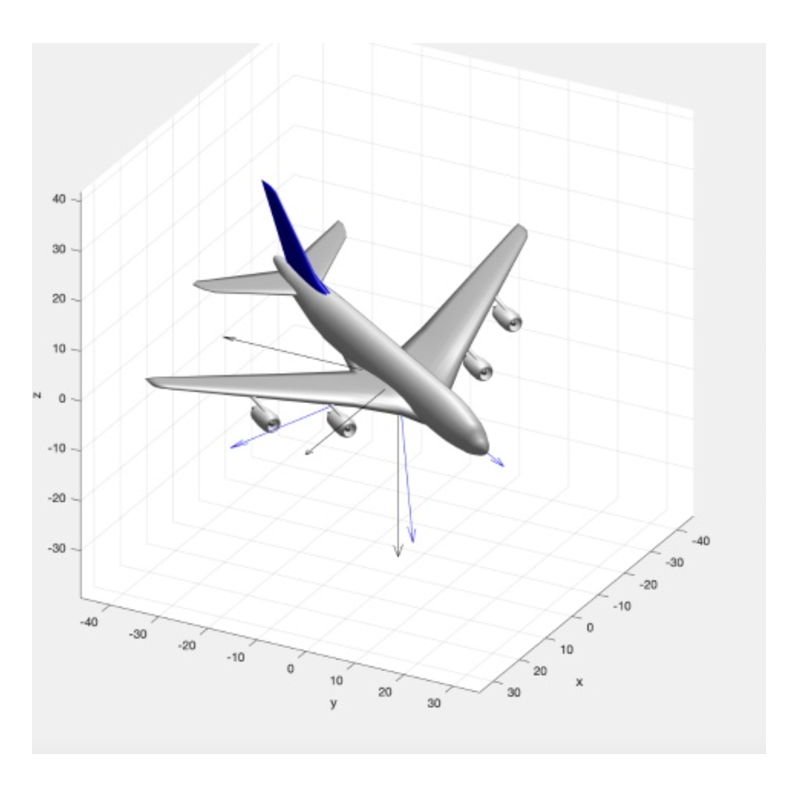

## Model

Linearised longitudinal dynamics of an aircraft in steady cruise (constant altitude and speed), from the [CTMS *Aircraft Pitch* example](https://ctms.engin.umich.edu/CTMS/index.php?example=AircraftPitch&section=SystemModeling) (University of Michigan). State $x = [\alpha\ \ q\ \ \theta]^T$, input $u = \delta$, output $y = \theta$:

$$
\dot{x} =
\begin{bmatrix}
-0.313 & 56.7 & 0 \\
-0.0139 & -0.426 & 0 \\
0 & 56.7 & 0
\end{bmatrix} x +
\begin{bmatrix} 0.232 \\ 0.0203 \\ 0 \end{bmatrix} \delta,
\qquad
y = \begin{bmatrix} 0 & 0 & 1 \end{bmatrix} x + 0 \cdot \delta
$$

Open-loop eigenvalues: $\lambda = 0,\ -0.3695 \pm 0.8860j$. Transfer function:

$$
G(s) = \frac{\Theta(s)}{\Delta(s)} = \frac{1.151\,s + 0.1774}{s^3 + 0.739\,s^2 + 0.9215\,s}
$$

The zero eigenvalue (θ integrates q) makes the plant simply, not asymptotically, stable. For Tasks 2–4 the model is discretised with forward Euler at $T_s = 0.1$ s: $A_d = I + T_s A$, $B_d = T_s B$. The controller is $u = K_r x$ with $K_r = -\texttt{place}(A_d, B_d, \lambda_{des})$.

| Symbol | Meaning |
|---|---|
| $\alpha$ | angle of attack |
| $q$ | pitch rate (normalised: $\dot\theta = \Omega q$) |
| $\theta$ | pitch angle (measured output) |
| $\delta$ | elevator deflection angle (control input) |
| $\mu$ | $\rho S \bar c / (4m)$: air density, wing area, mean chord, mass |
| $\Omega$ | $2U/\bar c$: equilibrium flight speed over mean chord ($= 56.7$, entry $A_{32}$) |
| $C_D,\ C_L,\ C_W,\ C_M$ | drag, lift, weight and pitching-moment coefficients |
| $\gamma$ | flight path angle, $\theta - \alpha$ |
| $i_{yy}$ | normalised moment of inertia about the pitch axis |
| $\sigma$ | $1/(1 + \mu C_L)$ |
| $\eta$ | $\mu \sigma C_M$ |

## Tasks and results

Full console output, including all gains: [`docs/console_output.txt`](docs/console_output.txt).

### 1. Eigenvalues, time constants, reachability and observability

The fastest time constant is $\tau = 2.71$ s. The system is completely reachable and observable, both in continuous time and after discretisation.

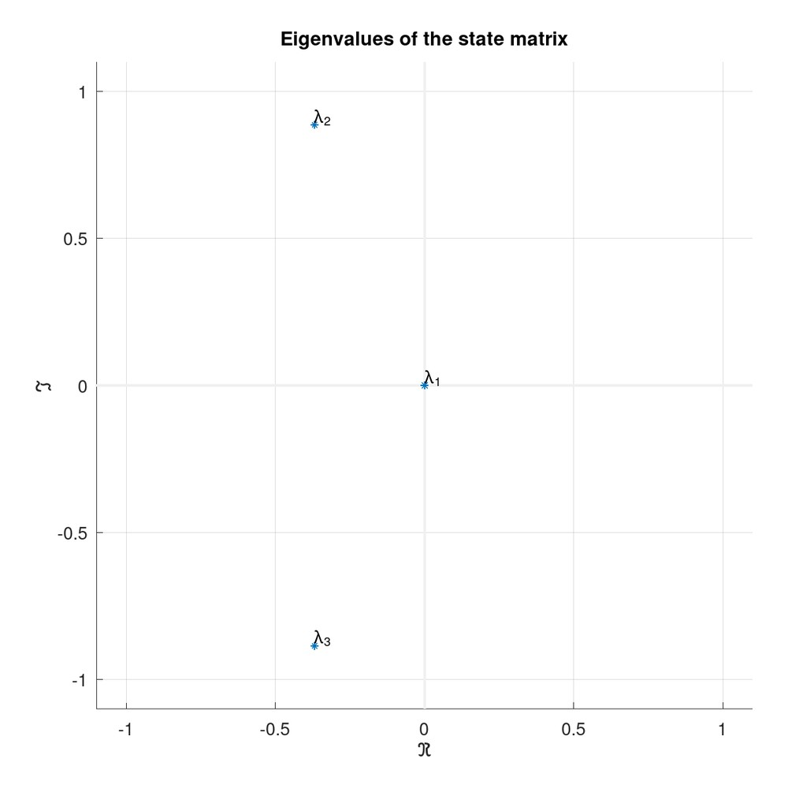 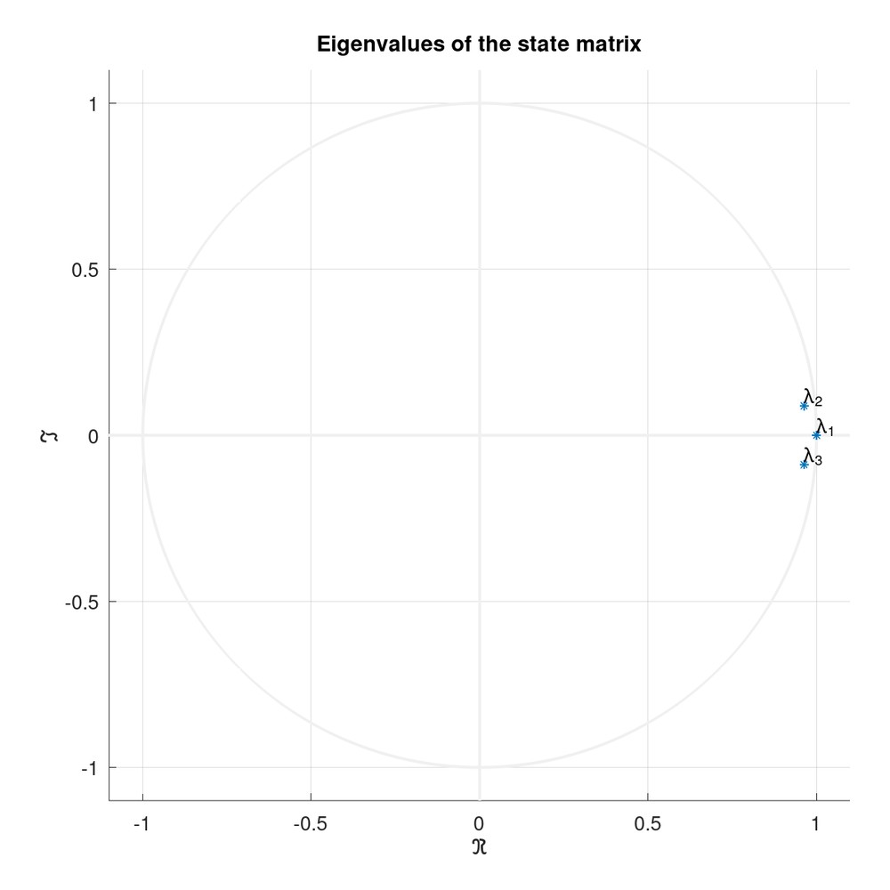

### 2. State feedback with time constants of about 5 s

Closed-loop eigenvalues are placed at $|\lambda| = e^{-T_s/5} \approx 0.980$, slightly spread apart (0.9802, 0.9801, 0.9800) because `place` cannot assign repeated poles. Starting from $\theta(0) = 15°$, the state converges to zero.

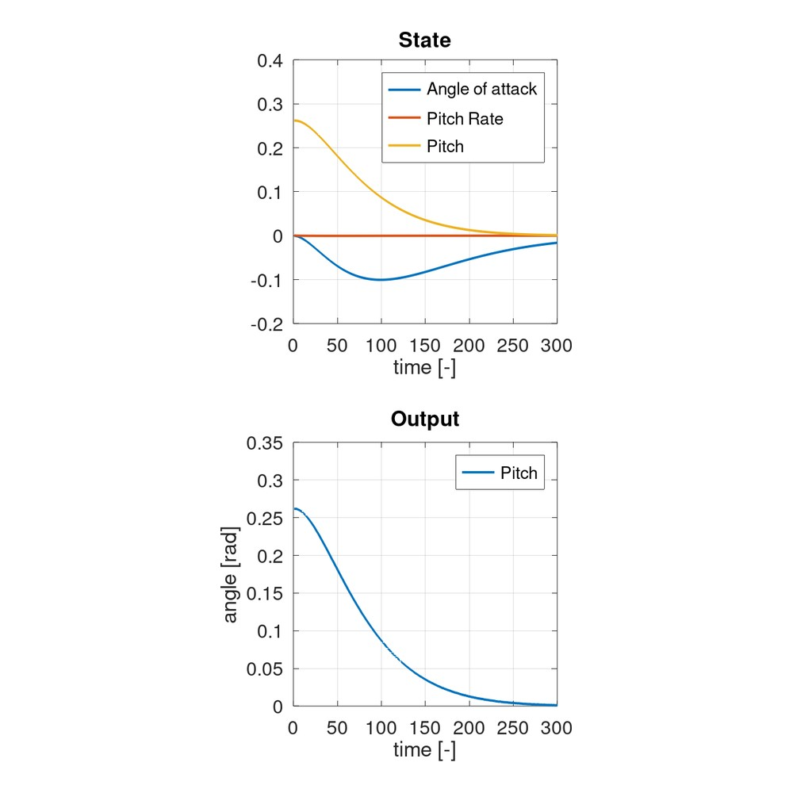 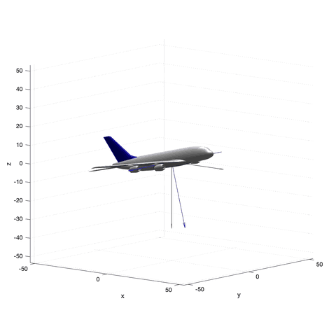

### 3. Output feedback on a 0.05 rad step

Reference tracking of $\theta_{ref} = 0.05$ rad from $x(0) = 0$ with $T_s = 100$ ms: state feedback with faster poles (≈ 0.959) plus a static feedforward gain $K_y = \left(C (I - A_d - B_d K_r)^{-1} B_d\right)^{-1}$ that gives unit DC gain.

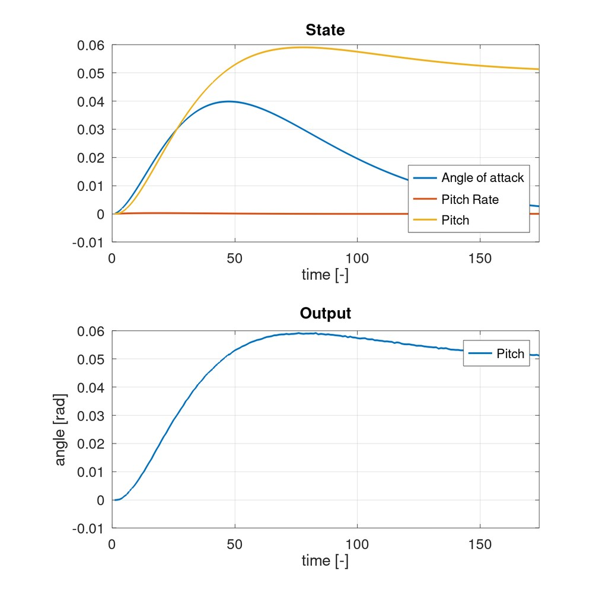 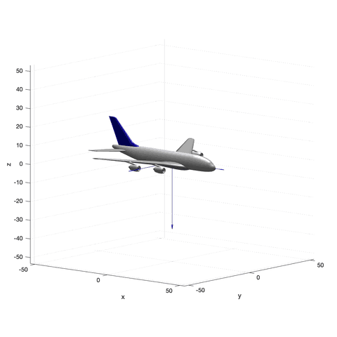

### 4. Luenberger vs Kalman observers

Controller-observer loops with the plant starting at $x(0) = [0\ \ 0\ \ 15°]^T$ and both observers starting at $\hat x(0) = [0.05\ \ 0\ \ 0.01]^T$. The Luenberger poles (≈ 0.931) are placed faster than the controller poles (≈ 0.947); the Kalman filter covariances are tuned so the two estimates behave similarly. The same controller gain is used in both loops.

Left: Luenberger. Right: Kalman. Solid lines are the true state, dashed lines the estimate.

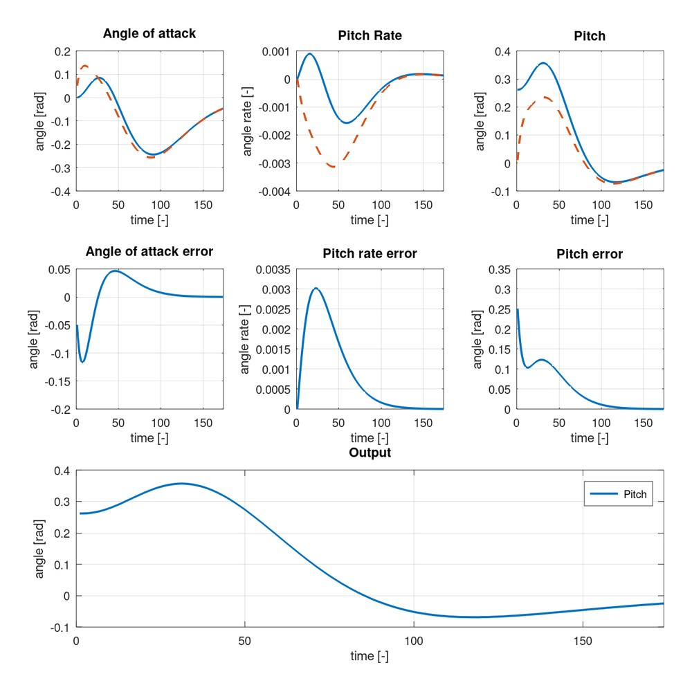 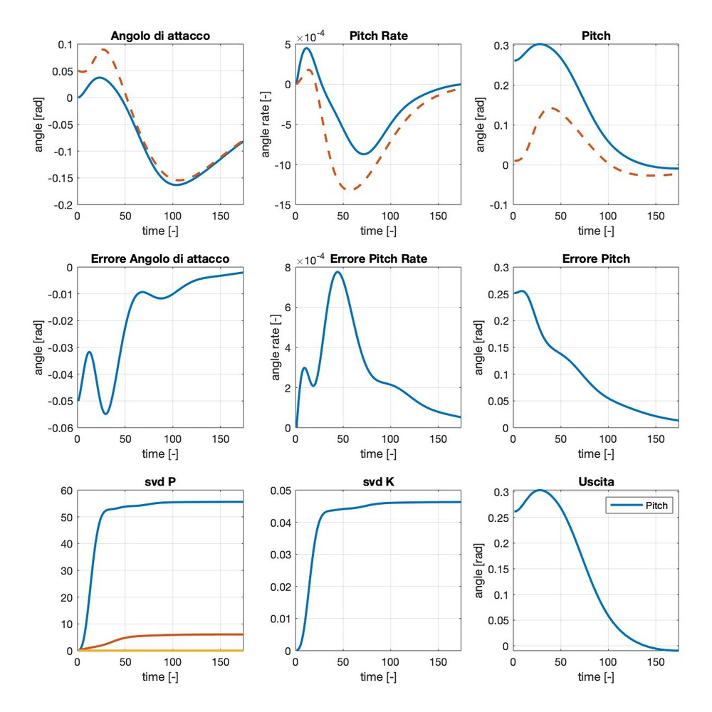

Animations driven by the estimated (left) and true (right) pitch angle, first Luenberger, then Kalman.

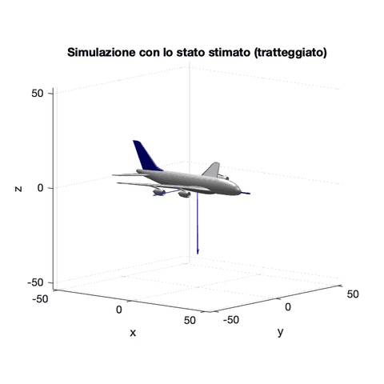 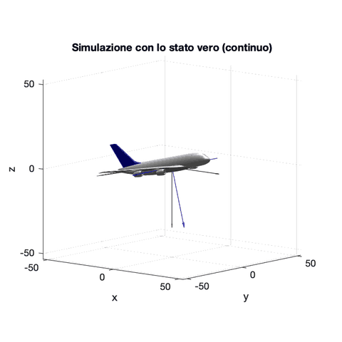

 

## Code

```
src/
├── main.m          entry point: model, analysis, Tasks 1–4
├── ALLFUNCS.m      helpers: gain design, Kalman loop, plots, 3D animation
├── A380.m          3D aircraft model for the animation (third-party, Stepen 2016)
└── open_loop.slx   Simulink open-loop model (Task 1, free response)
figures/            plots and animations shown above
docs/               console output of main.m
```

**Run:** open `src/` in MATLAB and run `main.m`. Press Enter to step through figures and animations.

**Requirements:** MATLAB R2019b or later with

- Control System Toolbox
- Statistics and Machine Learning Toolbox
- Image Processing Toolbox
- Simulink (only for `open_loop.slx`)
